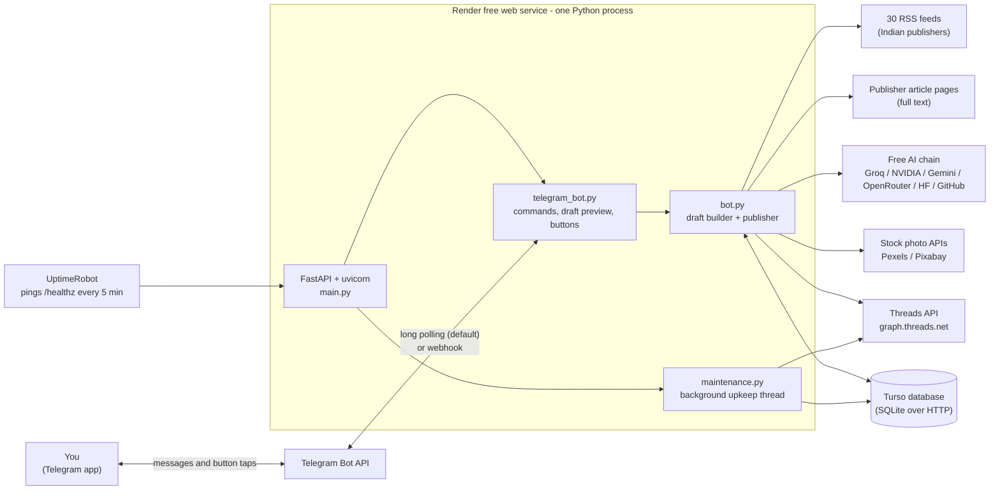
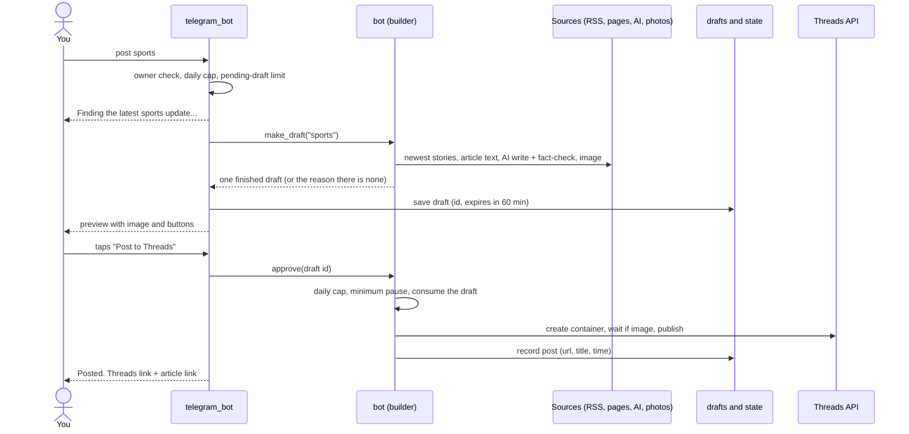
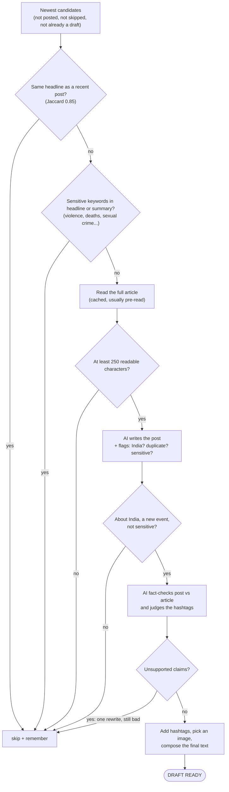
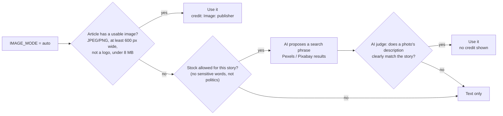

# Project overview: Indian news → Threads, on command

A personal, Telegram-controlled news agent. You message a Telegram bot (`post sports`); it finds the
newest suitable Indian news story in that category, reads the full article, has a free AI write a short
original post and fact-check it against the article, adds relevant hashtags and an image, and shows you
a **draft**. Nothing reaches Threads until you tap **✅ Post to Threads**.

It runs for free: Render (host) + Turso (database) + free AI and photo APIs, with no credit card.

**Contents**
1. [At a glance](#1-at-a-glance) · 2. [Architecture](#2-architecture) · 3. [Tech stack: what is used where](#3-tech-stack-what-is-used-where)
4. [Module guide](#4-module-guide) · 5. [Workflows](#5-workflows) · 6. [Data model](#6-data-model)
7. [External services](#7-external-services-and-their-limits) · 8. [Safety and compliance design](#8-safety-and-compliance-design)
9. [Configuration](#9-configuration) · 10. [Deployment](#10-deployment) · 11. [Testing and CI](#11-testing-and-ci)
12. [Security](#12-security) · 13. [Limitations and risks](#13-known-limitations-and-risks) · 14. [How it got here](#14-how-it-got-here) · 15. [Cheat sheet](#15-cheat-sheet)

---

## 1. At a glance

| | |
|---|---|
| **Purpose** | Turn the newest Indian news into short, accurate, credited Threads posts, one at a time, on your command |
| **Control** | Telegram bot (owner-only): `hi`, `post <category>`, `status`, `cancel` |
| **Categories** | india, business, technology, sports, entertainment, health, science, environment |
| **News sources** | 30 free RSS feeds from The Hindu, Times of India, Indian Express, Hindustan Times, Mint, Economic Times, Scroll |
| **AI** | A fallback chain of free providers (Groq, NVIDIA, Gemini, OpenRouter, Hugging Face, GitHub Models); each post is written, then fact-checked by a second AI pass |
| **Publishing** | Official Threads API (`graph.threads.net`); article image → licensed stock photo → text only |
| **Hosting (free, no card)** | Render web service + Turso database + UptimeRobot keep-alive (or Telegram webhook mode) |
| **Code** | Python 3.14 · 19 modules, about 2,800 lines · 177 automated tests (about 1,500 lines) · GitHub Actions CI |
| **Design stance** | Safety first: human approval, fact-check, no repeats, no sensitive stories, slow start for a new account |

---

## 2. Architecture

### 2.1 Big picture



One Python process does everything: it serves a tiny web API, listens to Telegram (in a background thread,
or through a webhook), and runs a maintenance thread. There is **no queue, no worker fleet and no
separate scheduler**: a command is handled in a short-lived thread, and the only long-lived threads are the
Telegram poller and the maintenance loop.

### 2.2 Layers

```
┌──────────────────────────────────────────────────────────────────────────────┐
│ Interface      telegram_bot.py   commands · draft preview · inline buttons    │
│                main.py           /healthz · / status · /telegram/webhook      │
│                cli.py            dry runs · --check-llm · --migrate-db        │
├──────────────────────────────────────────────────────────────────────────────┤
│ Orchestration  bot.py            builds drafts, approves/rejects, publishes   │
│                drafts.py         drafts waiting for your tap                  │
│                maintenance.py    pre-reading, token renewal, health checks    │
├──────────────────────────────────────────────────────────────────────────────┤
│ Intelligence   llm.py            writer + fact-checker + photo judge          │
│                safety.py         sensitive filter · warm-up · limits          │
├──────────────────────────────────────────────────────────────────────────────┤
│ Content        feeds.py · sources.py   RSS discovery · India filter           │
│                article.py              full article text                      │
│                images.py               article image / stock photo            │
├──────────────────────────────────────────────────────────────────────────────┤
│ Integrations   threads.py        publish · token renewal · permalink          │
│                alerts.py         warnings to your Telegram                    │
├──────────────────────────────────────────────────────────────────────────────┤
│ Foundation     state.py (SQLite or Turso) · cache.py · net.py · config.py     │
│                redact.py (no secret ever reaches a log or a message)          │
└──────────────────────────────────────────────────────────────────────────────┘
```

Dependencies point downwards only. `alerts.py` reaches the Telegram layer through a lazy import to avoid a cycle.

---

## 3. Tech stack: what is used where

### 3.1 By technology

| Technology | Version | Used for | Where |
|---|---|---|---|
| **Python** | 3.14.8 on Render (pinned in `.python-version`); 3.13 locally and in CI | The whole application | everywhere |
| **FastAPI** | 0.115.6 | The small web API: health check, status, Telegram webhook | `main.py` |
| **uvicorn** | 0.34.0 | ASGI server that runs the app | start command |
| **requests** | 2.32.3 | All outgoing HTTP (feeds, pages, Threads, Telegram, AI providers, stock APIs, Turso) through a shared per-thread session | `net.py` and its callers |
| **feedparser** | 6.0.11 | Reads RSS/Atom feeds | `feeds.py` |
| **BeautifulSoup 4** | 4.12.3 | Parses article HTML (JSON-LD, paragraphs, meta tags) and strips markup from feed text | `article.py`, `images.py`, `feeds.py` |
| **google-genai** | 2.30.1 | Google's SDK for Gemini (the only AI provider that is not called through plain HTTP) | `llm.py` |
| **Pillow** | 12.3.0 | Checks image size, shape and format | `images.py` |
| **python-dotenv** | 1.0.1 | Loads `.env` for local runs | `config.py` |
| **SQLite** (stdlib `sqlite3`) | built in | Local database file (`bot.db`) | `state.py` |
| **Turso** (libSQL over its HTTP API) | hosted | Persistent database on Render, which has no disk | `state.py` |
| **pytest** + **httpx** | 9.1.1 / 0.28.1 | 177 tests and the FastAPI test client | `tests/` |
| **GitHub Actions** | | CI on Python 3.13 and 3.14, plus a committed-secrets scan | `.github/workflows/ci.yml` |
| **Render** | free web service | Hosting | deployment |
| **UptimeRobot** | free plan | Pings `/healthz` so the free service never sleeps (not needed in webhook mode) | deployment |
| **Telegram Bot API** | | The user interface | `telegram_bot.py` |
| **Threads API** (Meta) | v1.0 | Publishing posts | `threads.py` |

Standard-library pieces worth knowing: `threading` (background work), `hashlib` (cache keys and the
webhook secret), `json`, `re` (the sensitive-story and India filters, hashtag cleaning), `dataclasses`/`typing.NamedTuple`.

### 3.2 By job: "which tech does this step use?"

| Job | Technology |
|---|---|
| Find new stories | RSS feeds + `feedparser`; HTML stripped with BeautifulSoup |
| Read the full article | `requests` + BeautifulSoup; JSON-LD `articleBody` first, then main paragraphs; promos removed with regular expressions |
| Write the post | A free AI model (see below) given the article text and your last 30 post titles |
| Fact-check the post | A second AI call that compares post and article and lists unsupported claims |
| Choose hashtags | The AI proposes; the fact-check pass drops irrelevant ones; code adds the category tag first and blocks filler words |
| Choose an image | Article page `og:image` / RSS picture, validated with Pillow; else a stock search (Pexels, Pixabay) whose candidates are judged by an AI from their text descriptions |
| Talk to you | Telegram Bot API: long polling or webhook; inline keyboards for the buttons; `sendPhoto` for the preview |
| Publish | Threads API: create a container, wait until an image is processed, then publish |
| Remember everything | SQLite file locally, Turso (HTTP) on Render; in-memory sets for speed |
| Stay awake and healthy | UptimeRobot ping, or Telegram webhook; background maintenance thread; Telegram alerts |
| Prove it works | pytest with fakes (no network, no AI), plus CI |

### 3.3 The AI chain (what "free AI" means here)

Tried in this order; a provider without a key is skipped, and one that fails goes on a cooldown so later
posts do not wait on it again (`LLM_CHAIN` reorders them).

| Order | Provider | How it is called | Default models |
|---|---|---|---|
| 1 | Groq | OpenAI-compatible HTTP | `openai/gpt-oss-20b`, `openai/gpt-oss-120b`, `qwen/qwen3.8-27b` |
| 2 | NVIDIA (build.nvidia.com) | OpenAI-compatible HTTP | `nvidia/nemotron-3.5-lightning-30b-a3b` |
| 3 | Google Gemini | `google-genai` SDK | `gemini-3.1-flash-lite`, then `gemini-3.5-flash-lite`, `gemini-flash-lite-latest` |
| 4 | OpenRouter | OpenAI-compatible HTTP | free `:free` models (Nemotron, Gemma) |
| 5 | Hugging Face | OpenAI-compatible HTTP | Llama 3.3 70B, Qwen 2.5 72B |
| 6 | GitHub Models | OpenAI-compatible HTTP | `openai/gpt-4.1-mini` |

The same chain performs three jobs: **write** the post, **fact-check** it (and judge its hashtags), and
**judge stock photos**. Model names on free tiers change often; `python -m app.cli --check-llm` tests every one.

---

## 4. Module guide

| Module | Lines | Responsibility | Key tech |
|---|---:|---|---|
| `main.py` | 58 | Starts everything (`lifespan`); `/healthz`, `/` status, `/telegram/webhook` | FastAPI |
| `telegram_bot.py` | 411 | Commands, draft preview, inline buttons, polling loop, webhook setup, duplicate-update guard | Telegram Bot API |
| `bot.py` | 277 | `_build` (the checking funnel), `make_draft`, `approve`, `reject`, `publish_draft` (with fallbacks), `run_once` | threading lock |
| `drafts.py` | 85 | Pending drafts in the state store: add, get, pop (consume), expire, count | JSON in `kv` |
| `llm.py` | 473 | Provider chain, pacing and cooldowns, writer prompt, fact-check, photo judge, caches, `compose` (post layout) | requests, google-genai |
| `safety.py` | 86 | Sensitive-topic regex, new-account warm-up, daily cap, minimum pause | regex |
| `feeds.py` | 95 | Fetch and normalise RSS, drop old items, India keyword filter for mixed feeds, 15-minute cache | feedparser |
| `sources.py` | 69 | The 30 feeds by category, and the India keyword list | |
| `article.py` | 210 | Full article text: JSON-LD → HTML paragraphs → summary; promo removal; prefetch in parallel; 30-minute cache | BeautifulSoup |
| `images.py` | 196 | Article image discovery and validation; stock search; judge; image modes | Pillow, requests |
| `threads.py` | 126 | Publish text/image posts, wait for image processing, permalink, token renewal | Threads API |
| `maintenance.py` | 76 | Every 12 minutes: database check, token renewal, pre-read top stories | thread |
| `alerts.py` | 51 | Telegram warnings with a per-kind cooldown | |
| `redact.py` | 58 | Removes tokens and keys from every log line, traceback and Telegram message | logging filter, regex |
| `state.py` | 278 | SQLite *or* Turso behind one API; in-memory caches; retries that never crash a post | sqlite3, Turso HTTP |
| `cache.py` | 33 | Thread-safe expiring cache | |
| `net.py` | 37 | One HTTP session per thread: connection reuse, safe retries, no cookies | requests |
| `config.py` | 125 | Every setting, read from environment variables | python-dotenv |
| `cli.py` | 50 | `--dry-run`, `--check-llm`, `--migrate-db` | argparse |

---

## 5. Workflows

### 5.1 The main one: `post sports`



If you tap **🔄 Another story** or **❌ Skip**, the story is remembered as skipped so it never comes back, and
(for "another") a new draft is prepared at once.

### 5.2 The checking funnel (inside `bot._build`)

Candidates are the newest stories first. Each one must pass **every** gate, cheapest first; the first that
passes becomes the draft. Up to 13 candidates are tried per command, and a rejected story is remembered so it is never checked again.



### 5.3 Writing and fact-checking

1. The writer prompt contains the article text (up to 4,500 characters), the category, and your **last 30
   post titles**. It returns JSON: `post`, `hashtags`, `photo_query`, and three flags: `india`, `duplicate`, `sensitive`.
2. Rules in the prompt: use only facts in the article; own words; be exact about who said or did what;
   **never use outside knowledge to say who a person is** (the cause of one early mistake, where a
   namesake was assumed); at most 280 characters.
3. A second AI call lists every claim the article does not clearly support and every hashtag that is not clearly about the story.
4. Unsupported claims → one rewrite with the problems listed → checked again → if still bad, the story is skipped.
5. If no AI can fact-check right now, nothing is published (it fails safe).
6. Results are cached (post 2 h, fact-check 6 h, photo judge 6 h), so the same story is never processed twice.

### 5.4 The post layout (`llm.compose`)

```
The post text (at most ~280 characters)

#Sports #ViratKohli            first tag = the category you asked for (the Threads topic); one or two story-specific
https://...article-link        always present
📷 Image: The Hindu            ONE attribution line: this when the picture is the article's own image,
                               otherwise "Source: The Hindu" (stock photo, or no picture). Never both.
```

The body never contains `#`, so the first hashtag in the text is always the category tag. Text is trimmed to
500 characters at a real sentence end (abbreviations like "Dr." and "Rs." are not sentence ends).

### 5.5 Image selection



Other modes: `stock` (licensed stock photos only, the lowest copyright risk), `article`, `off`. If Threads
rejects the chosen image at publish time, the post falls back **article image → stock photo → text** so it is never lost.

### 5.6 Approve and publish (`bot.approve`, `publish_draft`)

1. The draft still exists and has not expired.
2. `blocked_reason()`: the daily cap and the minimum pause (checked again here, not only when drafting).
3. A lock allows one build or publish at a time; the draft is **removed** from storage before publishing, which makes a double tap harmless.
4. Threads API: create a container (`TEXT` with a link-preview, or `IMAGE` with the link in the text), wait until an image container is `FINISHED`, then publish.
5. Record the post (URL, id, category, title, time); reply with the Threads link fetched from the API.
6. **Dry-run mode** replaces step 4 with a message showing what would have been posted.

### 5.7 Background upkeep (`maintenance.py`, every 12 minutes)

- Check the database is reachable (alert if not).
- Renew the Threads token when under 10 days are left, even if you have not posted (alert if it cannot).
- Refresh every category's feed and **pre-read the top 3 stories of each category**, so a command mostly finds its articles already fetched. It makes **no AI calls**, so it uses no free AI quota.
- Skipped entirely in dry-run mode, so a rehearsal never touches the real token.

### 5.8 Token lifecycle

A long-lived Threads token lasts about 60 days. The first renewal happens on first use; the new token and
its expiry are stored in the database. A new token pasted into the settings replaces the stored one
automatically. If renewal fails and expiry is within 7 days, you get a Telegram alert (at most every 12 hours).

### 5.9 Start-up and the two Telegram modes

`main.lifespan`: initialise the database (load posted/skipped sets and recent titles into memory) →
start the new-account clock if `THREADS_USER_ID` is new → start Telegram → start maintenance → send "🟢 Bot started".

| | Polling (default) | Webhook (optional) |
|---|---|---|
| How | The app repeatedly asks Telegram for updates (30 s long polls) | Telegram calls `POST /telegram/webhook` (secret header checked) |
| Free-host sleep | Needs UptimeRobot to stay awake | The service may sleep; your message wakes it (first reply about a minute) |
| Background upkeep and alerts | Always running | Only while awake |

### 5.10 Build, test and deploy

`git push` → GitHub Actions (compile, 177 tests on Python 3.13 and 3.14, secrets scan) → Render redeploys from
`main` (build `pip install -r requirements.txt`; start `uvicorn app.main:app --host 0.0.0.0 --port $PORT`).

---

## 6. Data model

**Tables** (same SQL on SQLite and Turso):

| Table | Columns | Purpose |
|---|---|---|
| `posted` | `url` (PK), `post_id`, `category`, `posted_at`, `title` | Everything published: duplicate prevention, daily cap, "same event" checks |
| `skipped` | `url` (PK), `reason`, `skipped_at` | Stories rejected (sensitive, not India, duplicate, thin text, owner skipped) so they are not re-checked |
| `kv` | `key` (PK), `value` | Settings and state: `threads_token`, `threads_token_seed`, `threads_token_expires_at`, `account_id`, `account_since`, `drafts` (JSON), `alert:<kind>` cooldown times |

**In memory** (rebuilt from the database at start-up): the sets of posted and skipped URLs (so choosing
candidates costs no database call per story), the last 3 days of titles, and the times of recent posts.
Settings are cached for 30 s. Other caches: feeds 15 min, article text 30 min, AI results 2–6 h.

**Failure behaviour:** a database write is retried 3 times and **never raises**: a post that has already
gone out is never lost because the database hiccuped. In-memory state stays correct and you are alerted.

---

## 7. External services and their limits

| Service | Role | Cost | Notes (limits change; check each provider) |
|---|---|---|---|
| Threads API (Meta) | Publishing | Free | 250 API posts per 24 h, 500 characters, one topic tag per post; your account must be a Threads Tester of your Meta app |
| Telegram Bot API | Interface | Free | Owner-only; inline buttons |
| Render | Hosting | Free | No persistent disk; sleeps after 15 minutes without traffic; 750 free hours a month; Render advises against free instances for production |
| Turso | Database | Free | Hosted SQLite over HTTP; plenty for this volume |
| UptimeRobot | Keep-alive | Free | 5-minute checks; personal use |
| Groq, NVIDIA, Gemini, OpenRouter, Hugging Face, GitHub Models | AI | Free tiers | Small quotas, models appear and disappear, occasional overload (503s); the chain and cooldowns absorb this |
| Pexels, Pixabay | Stock photos | Free | No attribution required. Unsplash's API terms do require it, so it is not a default |
| The publishers' RSS and pages | News | Free | Read at low volume with a clear User-Agent; NDTV and Gadgets 360 block automated page reads (HTTP 403), so they are not used |

---

## 8. Safety and compliance design

The first Threads account was permanently disabled, probably for posting 30+ times an hour, so the project
was rebuilt around **low volume, human approval and accuracy**.

| Risk | Control |
|---|---|
| Spam-like volume | Only on command (no automatic loop); minimum 5 minutes between posts; 15 posts per rolling 24 h; **new-account warm-up**: 3 a day for 3 days, 5 a day until day 7 (restarts when `THREADS_USER_ID` changes) |
| False statements | Full article text; "use only the article" prompt; a second AI **fact-check**; story skipped if unverifiable; nothing published if the checker is unavailable |
| Wrong content slipping through | **Preview and approve**: you see the exact text, image and link, and tap to publish |
| Repeats | Same URL; near-identical headline; the AI flags the same news event reported by another outlet (compared with your last 30 titles) |
| Harmful topics | Sensitive keyword filter (headline and summary) plus an AI `sensitive` flag on the full text; no stock photos for sensitive or political stories |
| Off-topic | India-only: keyword pre-filter for mixed feeds plus an AI `india` flag |
| Copyright | Article image credited to the publisher with a link back; `IMAGE_MODE=stock` avoids publishers' photos entirely; only Pexels/Pixabay by default; stock photos are never used for stories about named people or events |
| Attribution | Exactly one attribution line per post; the article link is always included |
| Platform rules | Official Threads API only (no scraping or browser automation); no repeated hashtag stuffing (maximum 3, no generic filler) |
| Accidents while testing | **Dry-run mode** publishes nothing and never touches the Threads token |

These controls reduce risk; they cannot guarantee a platform will never act on an account.

---

## 9. Configuration

All settings are environment variables (a `.env` file locally, Render's Environment tab in production).
`.env.example` lists them all; the important ones:

| Setting | Default | Meaning |
|---|---|---|
| `TELEGRAM_BOT_TOKEN`, `TELEGRAM_OWNER_ID` | | Your bot and the only account it obeys |
| `THREADS_USER_ID`, `THREADS_ACCESS_TOKEN` | | The Threads account to post to |
| `GROQ_API_KEY`, `NVIDIA_API_KEY`, `GEMINI_API_KEY`, `OPENROUTER_API_KEY`, ... | | AI keys; `LLM_CHAIN` sets the order |
| `PEXELS_API_KEY`, `PIXABAY_API_KEY` | | Stock photo keys |
| `TURSO_URL`, `TURSO_TOKEN` | empty | Use Turso instead of the local `bot.db` |
| `REQUIRE_APPROVAL` | `true` | Preview and approve before posting |
| `DRY_RUN` | `false` | Rehearsal: nothing is published |
| `DAILY_POST_LIMIT` / `MIN_SECONDS_BETWEEN_POSTS` | `15` / `300` | Posting limits |
| `ACCOUNT_WARMUP` | `true` | Slow start for a new account |
| `IMAGE_MODE` | `auto` | `auto`, `stock`, `article` or `off` |
| `SKIP_SENSITIVE`, `INDIA_ONLY` | `true` | Content filters |
| `MIN_ARTICLE_CHARS` / `ARTICLE_CHARS` | `250` / `4500` | Least text a story needs / how much the AI reads |
| `DRAFT_TTL_MINUTES` / `MAX_PENDING_DRAFTS` | `60` / `3` | Draft lifetime and how many may wait |
| `PREWARM`, `MAINTENANCE_MINUTES` | `true`, `12` | Background pre-reading |
| `TELEGRAM_MODE`, `PUBLIC_URL` | `polling`, | `webhook` needs a public URL (Render supplies `RENDER_EXTERNAL_URL`) |
| `ALERT_ON_START` | `true` | "Bot started" message on every restart |

---

## 10. Deployment

**Chosen setup (free, no card):** Render web service (Python 3.14.8) + Turso database + UptimeRobot.

- Render has no disk, so everything that must survive a restart (history, drafts, token, account clock) lives in **Turso**.
- Render sleeps after 15 minutes without traffic, so **UptimeRobot** hits `/healthz` every 5 minutes (or use `TELEGRAM_MODE=webhook`).
- Run **exactly one instance**: two copies on the same Telegram bot fight over messages.
- Locally: `uvicorn app.main:app` with a SQLite file. Never run a local copy on the live bot's token; use a separate test bot with `DRY_RUN=true`.
- Any always-on Linux VM with a disk also works (venv + systemd), with no Turso needed.

---

## 11. Testing and CI

- **177 tests** in `tests/` (about 8 seconds): safety rules, AI writing and fact-checking (with a scripted fake AI), article extraction, feeds, image order and publish fallbacks, state on SQLite **and** on a fake Turso server, secret redaction, the whole Telegram workflow (draft, approve, skip, double tap, limits, expiry, restart, strangers), alerts, token renewal, background upkeep and the webhook.
- Tests cannot use the network or a real AI: any attempt fails the test.
- Quality check: eight important behaviours were deliberately broken one at a time (double-post guard, daily cap, webhook secret, sensitive filter, fact-check, duplicate check, button ownership, topic tag), and the suite caught every one.
- **CI** (GitHub Actions) runs on every push: compile check, the tests on Python 3.13 and 3.14, and a scan that fails the build if something resembling an API key is committed.

---

## 12. Security

- **Owner-only:** every message and every button tap is checked against `TELEGRAM_OWNER_ID`; strangers are ignored.
- **Webhook secret:** Telegram's secret header is compared in constant time; otherwise 403.
- **No secrets in git:** `.env` and `*.db` are ignored; `.env.example` is blank; CI scans for keys.
- **No secrets in logs or messages:** a failing HTTP call puts the full web address in its error message,
  and some addresses contain a secret (Telegram's `/bot<token>/` path, `access_token=` and `key=` query
  strings). `redact.py` removes the configured secret values and those patterns from every log line,
  traceback and Telegram message. This was verified with a real failing request.
- **No cookies stored**; the database holds one Threads token, replaced when renewed.
- **Public endpoints:** `/healthz` and `/` need no login and show only non-secret status (counts, mode, recent public post links).
- **Rotate** any token that has appeared in a chat or log (for example the Telegram bot token via @BotFather).

---

## 13. Known limitations and risks

- **A platform can still act on any account.** The first account was permanently disabled; a new account made after a permanent disablement may break Meta's rules and could affect linked accounts.
- **AI can be wrong.** The fact-check is another AI, so it can miss an error or reject a good post. Always read the draft; that is what the approval step is for.
- **Free tiers are fragile.** AI models, quotas and prices change; Render sleeps and can restart; Turso and UptimeRobot terms may change.
- **Stock photos are judged by their text description,** not by looking at the picture, so a mismatch is possible. A stock photo carries no label, so a reader may assume it shows the story's subject.
- **Publishers' photos are their copyright.** Credit and a link are standard for news accounts but do not remove the risk.
- **Single user, single instance,** no multi-user or accounts system.
- **English-language Indian publishers only;** a few big sites block automated page reads and are excluded.
- **Sources of truth are the publishers.** The bot summarises; it does not independently verify news.

---

## 14. How it got here

1. **Started** as three scripts: crawl BBC with Ollama, write tweets, post to X by driving a browser with Selenium.
2. **X's API became paid** and browser login automation is against its terms, so posting moved to **Threads** (free, official API).
3. Rebuilt as a deployable service with a **free AI fallback chain**, India-only filtering, categories, images (article, then stock), hashtags.
4. Added **Telegram control**, first a continuous "start/stop posting" loop. That volume got the first account **permanently disabled**.
5. Redesigned for safety: **on-demand commands, preview and approve, fact-check, duplicate and sensitive filters, limits and warm-up**.
6. Moved hosting to **Render + Turso + UptimeRobot** (no card), then added speed-ups (pre-reading, caching), alerts, optional webhook mode, a proper **test suite and CI**.

---

## 15. Cheat sheet

| I want to... | Do this |
|---|---|
| See the commands | Send `hi` to the bot |
| Make a post | `post technology` → check the draft → tap ✅ |
| Rehearse without posting | `DRY_RUN=true` (see "Testing on your own PC" in `README.md`) |
| Run the tests | `pip install -r requirements-dev.txt` then `python -m pytest` |
| Check which AI providers work | `python -m app.cli --check-llm` |
| Check the Threads token and account (read-only, posts nothing) | `python -m app.cli --check-threads` |
| Preview a draft in the terminal | `python -m app.cli --dry-run --categories sports` |
| Move local history to Turso | `python -m app.cli --migrate-db bot.db` |
| Make posts safer for copyright | `IMAGE_MODE=stock` |
| Post immediately (no approval) | `REQUIRE_APPROVAL=false` (not recommended) |
| Let Render sleep when idle | `TELEGRAM_MODE=webhook` |

Further reading: `README.md` (setup and deployment steps), `.env.example` (every setting), `tests/` (executable examples of the behaviour above).
